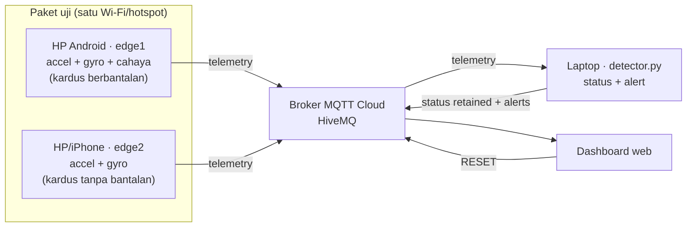

# SealGuard (Drop Test Box)

Proyek IoT untuk belajar: **kotak hitam untuk paket**. HP di dalam kardus memantau **benturan, jatuh, dan pembukaan paket** memakai **accelerometer + gyroscope + sensor cahaya**, dengan **pengolahan data di edge**, **MQTT Cloud**, **Decision Tree**, dan **dashboard web**. Data berasal dari sensor fisik HP.

Dua kardus dibandingkan: **edge1** (berbantalan, menentukan status) dan **edge2** (tanpa bantalan, pembanding). Dashboard menghitung persen peredaman bantalan.

## Cara kerja



Status: **TERSEGEL → BENTURAN → TERBUKA → RUSAK**. Status sengaja **di-latch** (hanya boleh naik) sampai RESET. Benturan lalu cahaya naik dalam 5 detik = kardus terbuka akibat jatuh (`RUSAK`).

## 1. Laptop: jalankan detector

Butuh **Python 3.10+** dan internet.

```bash
git clone https://github.com/<username>/<repo>.git
cd <repo>
python -m pip install -r requirements.txt
cp .env.example .env        # Windows PowerShell: Copy-Item .env.example .env
```

Ganti `PROJECT_ID` di `.env` menjadi nama kelompok yang unik (huruf, angka, `-`, `_`).

```bash
python detector.py
```

## 2. Dashboard

Buka `dashboard/index.html` langsung di browser, atau lewat GitHub Pages (`https://<username>.github.io/<repo>/dashboard/`). Isi `PROJECT_ID` yang sama, klik **Hubungkan**. Perlu internet (library `mqtt.js` dari CDN dan broker publik).

Isi: status + alasan + skor + metode (tree/threshold), grafik impact edge1 vs edge2 dengan garis ambang **dari detector**, persentase peredaman bantalan, log alert, dan tombol **RESET**.

## 3. HP edge: pilih salah satu cara

### Opsi A: Android + Termux (3 sensor)

```bash
pkg update && pkg install python git termux-api
pip install paho-mqtt python-dotenv
git clone https://github.com/<username>/<repo>.git && cd <repo>
cp .env.example .env                              # PROJECT_ID sama dengan laptop
python -m scripts.check_sensors                   # cek sensor dulu
python edge.py --device-id edge1                  # HP di dalam kardus utama
python edge.py --device-id edge2 --no-light       # HP kedua (kardus pembanding)
python edge.py --source simulator                 # latihan tanpa HP
```

[Panduan Android →](docs/ANDROID.md)

### Opsi B: iPhone (browser, tanpa Termux)

iOS hanya memberi akses sensor ke halaman **HTTPS**. Aktifkan **Settings → Pages → Source: GitHub Actions**, push ke `main`, lalu buka `https://<username>.github.io/<repo>/iphone/` di Safari. Isi `PROJECT_ID`, pilih peran, ketuk **Mulai membaca sensor**, izinkan Gerakan & Orientasi. Layar harus tetap menyala.

[Panduan iPhone →](docs/IPHONE.md)

## 4. Coba sistemnya

1. HP di kardus, diam → **TERSEGEL**
2. Angkat dan taruh pelan → tetap **TERSEGEL**
3. Jatuhkan dari 30 cm berbantalan → **BENTURAN**
4. Jatuhkan dari 50 cm atau tanpa bantalan → **RUSAK**
5. Senter ke kardus setelah benturan → `terbuka_akibat_jatuh`; tanpa benturan → **TERBUKA** (`dibuka_sengaja`)
6. Tekan **RESET** di dashboard sebelum skenario berikutnya

Pakai alas empuk, bantalan tebal, dan **jangan pakai HP utama**. Protokol lengkap: [docs/TESTING.md](docs/TESTING.md).

## Pelajari kodenya

- `edge.py` → NODE edge: baca sensor, olah per window, publish telemetry
- `detector.py` → NODE laptop: nilai status, latch, publish status dan alert
- `shared/processing.py` → pengolahan data: impact puncak, jumlah benturan, rotasi, melayang→mendarat, lux
- `shared/rules.py` → TERSEGEL / BENTURAN / TERBUKA / RUSAK + latch + fusion
- `shared/tree_model.py`, `train_tree.py`, `collect.py` → komponen Decision Tree
- `shared/sensors.py` → Termux (stream) dan simulator
- `iphone/index.html` → edge iPhone (logika sama dengan `processing.py`)
- `dashboard/index.html` → dashboard web

Dokumentasi: [Arsitektur](docs/ARCHITECTURE.md) · [MQTT & konfigurasi](docs/SETUP.md) · [Algoritma](docs/LEARNING.md) · [Dashboard](docs/DASHBOARD.md) · [Protokol uji](docs/TESTING.md) · [Security](docs/SECURITY.md)

## Decision Tree (komponen AI)

Tanpa `model.json`, detector memakai threshold. Dengan `model.json`, Decision Tree menentukan tingkat benturan (TERSEGEL / BENTURAN / RUSAK); aturan cahaya, fusion, dan latch tetap sama.

```bash
python edge.py --device-id edge1                                   # HP di kardus
python collect.py --label TERSEGEL --note "taruh pelan 10cm"       # laptop, 10-15 kali lalu Ctrl+C
python collect.py --label BENTURAN --note "30cm berbantalan"
python collect.py --label RUSAK --note "50cm tanpa bantalan"
pip install -r requirements-train.txt
python train_tree.py                                               # -> model.json + laporan
python detector.py                                                 # otomatis memakai model.json
```

Aturan penting: label harus mencerminkan **kriteria kelompok yang ditetapkan sebelum uji**, bukan keluaran threshold di kode (kalau tidak, pohon hanya menghafal threshold). Jika label berasal dari skenario (tinggi + bantalan), tulis di laporan bahwa itu **label protokol**. Detail: [docs/TESTING.md](docs/TESTING.md).

## Kalibrasi

Semua ambang di `.env` adalah tebakan awal. Jatuhkan kardus 20-30 kali dengan ketinggian dan bantalan berbeda, catat `impact_peak_g`, lalu tentukan ambang dari data itu.

## HP tidak terbaca?

- **Android:** `python -m scripts.check_sensors`; izinkan Termux:API di pengaturan Android.
- **iPhone:** lihat indikator "Sampel / detik" dan pesan di halaman; pastikan HTTPS.
- `PROJECT_ID` harus sama di laptop, dashboard, dan semua HP; `detector.py` harus berjalan.

## Tes

```bash
python -m unittest discover -s tests -t .
```

> Proyek pembelajaran, bukan sistem produksi. Sampling sensor HP terbatas, jadi puncak benturan yang terbaca cenderung lebih kecil dari aslinya; bandingkan nilai relatif antar percobaan. Broker publik tidak punya autentikasi/ACL.
