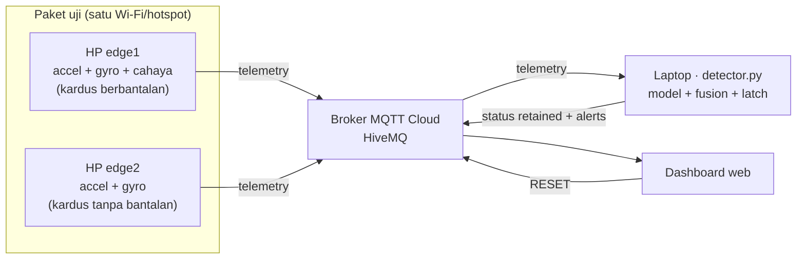
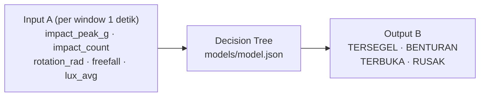

# SealGuard (Drop Test Box) · Kelompok 4


**Kotak hitam untuk paket ekspedisi.** HP di dalam kardus memantau **benturan, jatuh, dan pembukaan paket** memakai accelerometer, gyroscope, dan sensor cahaya. Data diolah di edge, dikirim lewat **MQTT**, dinilai oleh **Decision Tree (Supervised Learning)** dan aturan fusion, lalu ditampilkan di **dashboard web**.

Mata kuliah Internet of Things · Video demo: **[tempel link video]**

## Masalah dan ide

Paket pecah belah sering dibanting atau dibuka di tengah jalan, dan pengirim maupun penerima baru tahu setelah barangnya rusak. SealGuard menaruh HP di dalam kardus sebagai "kotak hitam": ia merekam gerakan dan cahaya, lalu menilai paket **TERSEGEL / BENTURAN / TERBUKA / RUSAK**. Dua kardus dibandingkan: **edge1** (berbantalan, menentukan status) dan **edge2** (tanpa bantalan, pembanding).

## Cara kerja



## AI: Supervised Learning



Model belajar dari contoh berlabel yang dikumpulkan kelompok (`collect.py`), dievaluasi pada **sesi yang tidak ikut dilatih** (`train_tree.py`), dan dibandingkan dengan threshold buatan tangan. Fusion (benturan lalu cahaya naik ≤ 5 detik = RUSAK) dan latch tetap berupa aturan. Detail: [docs/AI.md](docs/AI.md). Hasil terbaru: [reports/ai_report.md](reports/ai_report.md) (dibuat setelah `train_tree.py` dijalankan).

## Hasil percobaan

| Percobaan 1: kardus dijatuhkan | Percobaan 2: kardus dibuka |
|---|---|
|  |  |
| impact **5,04 g** dan **5,83 g** (> 5 g), cahaya 0 lux | cahaya naik dari 0 ke **11,0 lux** |

Tabel lengkap, metode baca, dan temuan: [docs/RESULTS.md](docs/RESULTS.md).

## Quick start

Butuh **Python 3.10+** dan internet.

### 1. Laptop: detector

```bash
git clone https://github.com/najelanaura/sealguard_kel_4.git
cd sealguard_kel_4
python -m pip install -r requirements.txt
cp .env.example .env        # Windows PowerShell: Copy-Item .env.example .env
python detector.py
```

`PROJECT_ID` di `.env` harus unik dan **sama** di semua perangkat. Tanpa `models/model.json` detector memakai threshold; dengan model, panel dashboard menampilkan metode **tree**.

### 2. Dashboard

Buka `dashboard/index.html` di browser (atau GitHub Pages), isi `PROJECT_ID`, klik **Hubungkan**. Status awal harus **TERSEGEL**; kalau masih "menunggu data dari detector.py", detector belum berjalan.

### 3. HP edge (pilih satu)

**Android + Termux (3 sensor, termasuk cahaya)**

```bash
pkg update && pkg install python git termux-api
pip install paho-mqtt python-dotenv
git clone https://github.com/najelanaura/sealguard_kel_4.git && cd sealguard_kel_4
cp .env.example .env
python -m scripts.check_sensors
python edge.py --device-id edge1                  # HP di kardus utama
python edge.py --device-id edge2 --no-light       # HP kedua
python edge.py --source simulator                 # latihan tanpa HP
```

**iPhone (browser, tanpa Termux)**: aktifkan Settings → Pages → Source: GitHub Actions, push ke `main`, buka `https://najelanaura.github.io/sealguard_kel_4/iphone/` di Safari. Panduan: [docs/IPHONE.md](docs/IPHONE.md), [docs/ANDROID.md](docs/ANDROID.md).

### 4. Melatih model AI

```bash
python collect.py --label RUSAK --height-cm 50 --padding tidak --note "50cm tanpa bantalan"
pip install -r requirements-train.txt
python train_tree.py
```

Skenario lengkap dan aturan label: [docs/TESTING.md](docs/TESTING.md). Panduan merekam video: [docs/DEMO.md](docs/DEMO.md).

## Struktur repo

```
sealguard_kel_4/
├─ detector.py            # laptop: nilai status, latch, publish status & alert
├─ edge.py                # HP Android: baca sensor, olah per window, publish telemetry
├─ collect.py             # catat telemetry + label -> data/drops.csv
├─ train_tree.py          # latih Decision Tree -> models/model.json + reports/
├─ shared/                # config, features (A->B), processing, rules, sensors, tree_model
├─ dashboard/             # dashboard web (MQTT over WebSocket)
├─ iphone/                # edge iPhone (DeviceMotion -> MQTT)
├─ scripts/               # check_sensors, make_synthetic_dataset (khusus uji alur)
├─ data/  models/  reports/
├─ docs/                  # ARCHITECTURE, SETUP, AI, LEARNING, TESTING, RESULTS, DEMO, RUBRIK, ...
├─ tests/                 # unit test (python -m unittest discover -s tests -t .)
└─ .github/workflows/     # CI + GitHub Pages
```

## Dokumentasi

[Arsitektur](docs/ARCHITECTURE.md) · [MQTT & konfigurasi](docs/SETUP.md) · [AI](docs/AI.md) · [Algoritma](docs/LEARNING.md) · [Protokol uji](docs/TESTING.md) · [Hasil](docs/RESULTS.md) · [Dashboard](docs/DASHBOARD.md) · [Video demo](docs/DEMO.md) · [Rubrik](docs/RUBRIK.md) · [Security](docs/SECURITY.md)

## Tim

| Nama | Peran |
|---|---|
| [Nama anggota 1] | Edge dan pengumpulan data |
| [Nama anggota 2] | iPhone, cloud, dashboard |
| [Nama anggota 3] | Detector, AI, dokumentasi |

## Catatan keselamatan dan batasan

Pakai HP bekas, bantalan tebal, ketinggian rendah, dan alas empuk. Broker publik tidak punya autentikasi: pakai `PROJECT_ID` unik dan jangan kirim data pribadi. Sampling sensor HP terbatas sehingga puncak benturan bisa terbaca lebih kecil dari aslinya.

## Lisensi

Lihat [LICENSE](LICENSE).
